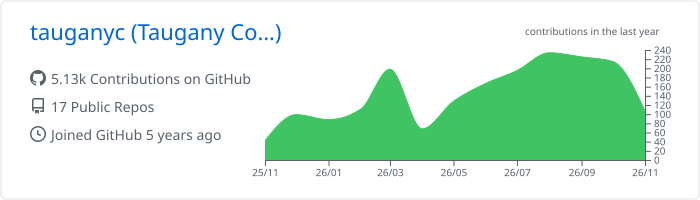
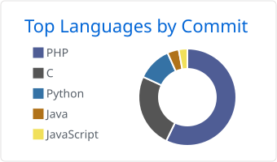
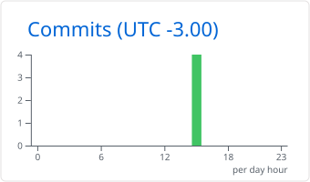

  
  
  

  
  
  
  
  

## Sobre mim

**Desenvolvedor Laravel Sênior** com foco em backend, construindo e evoluindo **sistemas escaláveis e APIs REST de alta performance** desde **2022**. Antes disso, fui **responsável de TI em um hospital (2019–2024)**, cuidando de servidores Linux, redes e da integração de equipamentos médicos.

Tenho experiência em **modelagem e otimização de PostgreSQL e MySQL em cenários de alto volume**, **refatoração de sistemas legados**, uso de **cache** para escalar, **mensageria (SNS/SQS)** com o padrão **Message Outbox**, e **CI/CD** com GitHub Actions e GitLab CI/CD em ambientes Linux e Docker.

A maior parte do meu trabalho está em **repositórios privados**, por isso o gráfico de contribuições mostra bem mais do que os projetos públicos abaixo.

### O que eu construo

- 🎯 **Aquisição e retenção de leads:** da captura ao processamento, com regras de decisão em fluxos de redirecionamento. Liderei a **unificação dos sistemas de redirecionamento** numa arquitetura configurável e escalável
- 📈 **Tracking e analytics:** coleta de eventos (pageviews, sessões e parâmetros) com foco em alta performance e consistência dos dados, além de dashboards integrando **ActiveCampaign** e ferramentas internas
- 🔒 **Performance de banco de dados:** normalização, otimização de queries e estratégias para **reduzir contenção e evitar locks** em alto volume
- 📨 **Mensageria em escala:** plataformas de disparo de **e-mail** (SendGrid) e **Web Push** (VAPID), com segmentação de audiência, automações em etapas e processamento de webhooks de eventos
- ⚙️ **Arquitetura orientada a eventos:** workers independentes consumindo **AWS SQS/SNS**, padrão **Outbox**, **Dead Letter Queues** com redrive e filas **Redis + Laravel Horizon**
- 🔌 **APIs:** REST em **Laravel** (Sanctum, Octane, documentação OpenAPI/Swagger) e **FastAPI** (Pydantic, SQLAlchemy/Alembic, APScheduler), roteamento de tráfego e verificação de e-mails
- 🗄️ **Dados:** **MySQL**, **PostgreSQL** (incluindo Postgres distribuído com **Citus**), **MongoDB** para centralização de logs, **Redis**, **Meilisearch** e **DuckDB**
- 📊 **Painéis e produtos internos:** painéis administrativos, funis de leads (quizzes e formulários), CMS, integração com **Google Ads API** e editores visuais de fluxo em **React Flow**
- ☁️ **Cloud e DevOps:** **Docker**, **Kubernetes + Helm + ArgoCD (GitOps)**, Nginx, Caddy, Supervisor, CI/CD com **GitHub Actions**, AWS (SQS, SNS, S3, LocalStack) e Google Cloud Storage
- 🔭 **Observabilidade:** OpenTelemetry, centralização de logs e health checks
- 🤖 **IA aplicada:** integrações com OpenAI e LLMs, servidores MCP para Laravel, terminal multiagente em Electron e pipelines de geração de vídeo com TTS e Whisper

## Stack

<table>
  <tr>
    <td><b>Linguagens</b></td>
    <td></td>
  </tr>
  <tr>
    <td><b>Backend</b></td>
    <td>
       
            
    </td>
  </tr>
  <tr>
    <td><b>Bancos de dados</b></td>
    <td>
       
        
    </td>
  </tr>
  <tr>
    <td><b>Mensageria</b></td>
    <td>    </td>
  </tr>
  <tr>
    <td><b>Cloud & DevOps</b></td>
    <td>
       
            
    </td>
  </tr>
  <tr>
    <td><b>Frontend</b></td>
    <td>
       
          
    </td>
  </tr>
  <tr>
    <td><b>Qualidade</b></td>
    <td>      </td>
  </tr>
  <tr>
    <td><b>Arquitetura e métodos</b></td>
    <td>      </td>
  </tr>
  <tr>
    <td><b>IA</b></td>
    <td>       </td>
  </tr>
</table>

## Experiência

**Desenvolvedor Laravel Sênior** · Marketing digital e geração de leads · Pelotas, RS · *06/2022 – atual*
- Desenvolvimento e evolução dos sistemas de **aquisição e retenção de leads** e dos fluxos de redirecionamento
- **Tracking e analytics** de alta performance (pageviews, sessões e parâmetros)
- Modelagem e otimização de **PostgreSQL e MySQL**, eliminando contenção e locks em alto volume
- **Unificação dos sistemas de redirecionamento** numa arquitetura configurável e escalável
- **Refatoração de sistemas legados** com configuração centralizada e cache
- **Mensageria (SNS e SQS)** e processamento assíncrono com o padrão **Message Outbox**
- Aplicações em **Docker**, pipelines de **CI/CD** (GitHub Actions e GitLab) e troubleshooting de **servidores Linux** em produção
- **Dashboards** integrando dados do ActiveCampaign e de ferramentas internas

**Responsável de TI** · Associação hospitalar · Guaíba, RS · *11/2019 – 10/2024*
- Infraestrutura e operação de TI da unidade: **servidores Linux**, redes, controle de acesso e biometria
- Configuração e otimização do sistema hospitalar **SIGH (Hospidata)** e do faturamento SUS
- Integração de **eletrocardiógrafos, raio-x e tomógrafos** com servidores Linux e com o sistema de imagens Animati (PACS)

## Formação e certificações

- 🎓 **Tecnologia em Sistemas para Internet** · IFSUL (Charqueadas, RS) · *em andamento*
- 🥇 **Medalha de ouro** · Charcode 2023, competição de programação em Charqueadas
- 📜 Udemy: Desenvolvimento Web Avançado com PHP, Laravel e Vue.js (2024) · Docker (2023) · PHP 7 (2023) · Desenvolvimento Web (2022) · Algoritmos e Lógica de Programação (2022)

## Estatísticas

  <picture>
    <source media="(prefers-color-scheme: dark)" srcset="./profile-summary-card-output/github_dark/0-profile-details.svg" />
    
  </picture>

  <picture>
    <source media="(prefers-color-scheme: dark)" srcset="./profile-summary-card-output/github_dark/1-repos-per-language.svg" />
    
  </picture>
  <picture>
    <source media="(prefers-color-scheme: dark)" srcset="./profile-summary-card-output/github_dark/2-most-commit-language.svg" />
    
  </picture>

  <picture>
    <source media="(prefers-color-scheme: dark)" srcset="./profile-summary-card-output/github_dark/3-stats.svg" />
    
  </picture>
  <picture>
    <source media="(prefers-color-scheme: dark)" srcset="./profile-summary-card-output/github_dark/4-productive-time.svg" />
    
  </picture>

  <picture>
    <source media="(prefers-color-scheme: dark)" srcset="https://streak-stats.demolab.com?user=tauganyc&theme=github-dark-blue&hide_border=true&locale=pt_BR&date_format=j%2Fn%5B%2FY%5D" />
    
  </picture>

## Trajetória

| Ano | Contribuições | Destaques |
|---|---:|---|
| **2026** | 1.700+ | Plataforma de disparo orientada a eventos (SQS/SNS, Outbox, DLQ, Postgres/Citus), CMS em React e Nuxt, Web Push com FastAPI, logs centralizados em MongoDB, deploy em Kubernetes com Helm e ArgoCD, ferramentas com IA e MCP |
| **2025** | 1.780+ | Painel administrativo em Laravel (mais de 500 commits no ano), API de automação de marketing v2, funis de leads, serviços em FastAPI para roteamento de tráfego e verificação de e-mails |
| **2024** | 1.130+ | Evolução do painel administrativo e das APIs, automação de marketing com filas no Horizon, quizzes, integração com Google Ads API e primeiro serviço em FastAPI |
| **2023** | 360+ | Medalha de ouro no Charcode; dashboards e sistemas de pesquisa em produção, início no painel administrativo e nas APIs em Laravel, primeiros ambientes em Docker |
| **2022** | 100+ | Início como desenvolvedor Laravel (06/2022) e primeiros sistemas mantidos em produção |
| **2021** | 13 | Graduação no IFSUL e lógica de programação em C, em paralelo à TI hospitalar |
| **2019** | n/d | Início na área como responsável de TI hospitalar: servidores Linux, redes e integração de equipamentos |

Números consolidados em novembro de 2026, incluindo contribuições em repositórios privados.

## Projetos públicos

| Projeto | Descrição | Stack |
|---|---|---|
| [**encurtador-eng-1**](https://github.com/tauganyc/encurtador-eng-1) | Encurtador de URLs com autenticação e relatório diário de cliques por link | Laravel · MySQL · Bootstrap |
| [**hackaton-2024**](https://github.com/tauganyc/hackaton-2024) | Plataforma que conecta empresas e investidores: propostas, investimentos e conta digital | Laravel · MySQL · Bootstrap |
| [**back-end-2**](https://github.com/tauganyc/back-end-2) | Marketplace de carros usados com camadas de controller, service e repository | PHP · MySQL |
| [**POO-PROJECT**](https://github.com/tauganyc/POO-PROJECT) | Sistema de biblioteca com empréstimos e persistência em arquivos, aplicando POO | Java |
| [**SeletivoDell**](https://github.com/tauganyc/SeletivoDell) | Análise de dados de preços de medicamentos (ANVISA) a partir de CSV | Python |

## Atividade

<picture>
  <source media="(prefers-color-scheme: dark)" srcset="https://raw.githubusercontent.com/tauganyc/tauganyc/output/snake-dark.svg" />
  
</picture>

Estatísticas atualizadas automaticamente todo dia via GitHub Actions.

