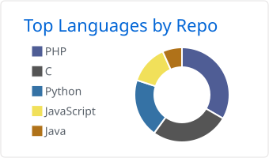
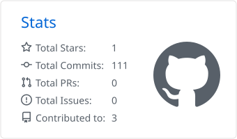

  
  
  

## Sobre mim

Desenvolvedor **backend** focado em **PHP / Laravel** e **Python**, construindo e mantendo **sistemas em produção** desde 2023: APIs, plataformas internas e serviços de alto volume. A maior parte do meu trabalho está em repositórios privados de empresa, por isso o gráfico de contribuições mostra muito mais do que os projetos públicos abaixo.

**O que eu desenvolvo no dia a dia:**

- 📨 **Automação de marketing e mensageria:** plataformas de disparo de e-mail e push, filas de envio, verificação de e-mails e roteamento de tráfego
- 🔌 **APIs e integrações:** APIs REST em Laravel, serviços em Python e integração entre sistemas
- 📊 **Painéis e dashboards:** painéis administrativos, relatórios de monetização e funis de captura de leads (quizzes e formulários)
- 🪵 **Observabilidade:** centralização de logs e monitoramento das aplicações
- ☁️ **Infraestrutura:** Docker, GitOps e infraestrutura como código com Terraform
- 🤖 **IA aplicada:** ferramentas internas e automações com LLMs e geração de conteúdo

## Stack

| Área | Tecnologias |
|---|---|
| **Backend** |  |
| **Frontend** |  |
| **Banco de dados** |  |
| **DevOps / Infra** |  |
| **Também já usei** |  |

## Estatísticas

  <picture>
    <source media="(prefers-color-scheme: dark)" srcset="./profile-summary-card-output/github_dark/0-profile-details.svg" />
    
  </picture>

  <picture>
    <source media="(prefers-color-scheme: dark)" srcset="./profile-summary-card-output/github_dark/1-repos-per-language.svg" />
    
  </picture>
  <picture>
    <source media="(prefers-color-scheme: dark)" srcset="./profile-summary-card-output/github_dark/2-most-commit-language.svg" />
    
  </picture>

  <picture>
    <source media="(prefers-color-scheme: dark)" srcset="./profile-summary-card-output/github_dark/3-stats.svg" />
    
  </picture>
  <picture>
    <source media="(prefers-color-scheme: dark)" srcset="./profile-summary-card-output/github_dark/4-productive-time.svg" />
    
  </picture>

  <picture>
    <source media="(prefers-color-scheme: dark)" srcset="https://streak-stats.demolab.com?user=tauganyc&theme=github-dark-blue&hide_border=true&locale=pt_BR&date_format=j%2Fn%5B%2FY%5D" />
    
  </picture>

## Trajetória

| Ano | Contribuições | Destaques |
|---|---:|---|
| **2026** | 1.700+ | Plataformas de automação e mensageria, infraestrutura como código, ferramentas com IA |
| **2025** | 1.780+ | Evolução de APIs e painéis em produção, serviços em Python, frontends em React |
| **2024** | 1.130+ | Consolidação em Laravel: APIs, painel administrativo, roteamento de links e hackathon |
| **2023** | 360+ | Primeiros sistemas em produção: dashboards, pesquisas e APIs em PHP |
| **2022** | 100+ | PHP e Python: sistemas web acadêmicos e processos seletivos |
| **2021** | 13 | Início: lógica e programação estruturada em C |

Números consolidados em novembro de 2026, incluindo contribuições em repositórios privados.

## Projetos públicos em destaque

| Projeto | Descrição | Stack |
|---|---|---|
| [**encurtador-eng-1**](https://github.com/tauganyc/encurtador-eng-1) | Encurtador de URLs com autenticação e relatório diário de cliques por link | Laravel · MySQL · Bootstrap |
| [**hackaton-2024**](https://github.com/tauganyc/hackaton-2024) | Plataforma que conecta empresas e investidores: propostas, investimentos e conta digital | Laravel · MySQL · Bootstrap |
| [**back-end-2**](https://github.com/tauganyc/back-end-2) | Marketplace de carros usados com camadas de controller, service e repository | PHP · MySQL |
| [**POO-PROJECT**](https://github.com/tauganyc/POO-PROJECT) | Sistema de biblioteca com empréstimos e persistência em arquivos, aplicando POO | Java |
| [**SeletivoDell**](https://github.com/tauganyc/SeletivoDell) | Análise de dados de preços de medicamentos (ANVISA) a partir de CSV | Python |

## Atividade

<picture>
  <source media="(prefers-color-scheme: dark)" srcset="https://raw.githubusercontent.com/tauganyc/tauganyc/output/snake-dark.svg" />
  
</picture>

Estatísticas atualizadas automaticamente todo dia via GitHub Actions.

